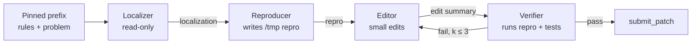

# Gemma 4 Agent Paper — Solo Research Plan

Sep 25, 2026 · @shashanka

## Thesis and contributions

Target: the Gemma 4 Developer Agent **Paper Track**, final deadline Nov 12, 2026 (about 7 weeks, solo). The main leaderboard (final Dec 2) reuses the same artifacts.

**Thesis:** for small local coding agents, the binding constraint is the runtime — wall-clock and a 32k context window — not the weights. How tokens are spent matters more than which adapter is loaded.

**Working title:** *Runtime-Bound: Wall-Clock and Context Scaling for Local Software-Engineering Agents.*

1. **Frontier (C1).** A budget-matched measurement of resolved rate vs wall-clock across model size, precision, thinking budget, attempts and localization tooling, on hardware that reproduces the evaluation box.
2. **Context runtime (C2, headline).** A prefix-stable, phase-decomposed agent that treats the 32k window as a prefix-closed cache: pinned prefix, evictable working tail, fresh sub-agent contexts per phase. Built entirely within the declarative submission rules.
3. **Oracle bound (C3, scoped).** An offline oracle for context eviction, extending the prefix-constrained Belady result with a value term, computed on logged trajectories to show how close the online policy gets.
4. **Self-bootstrap ablation (C4, optional).** One round of rejection-sampling LoRA fine-tuning on Gemma's own successful trajectories. No proprietary-model distillation.

## Constraints

The evaluation box and a single RTX 5090 are close enough that the 5090 can serve as a faithful simulator. Details below come from a competitor's digest of the organizers' harness spec; verify against the official Kaggle pages in week 1.

| Constraint | Evaluation environment | Local RTX 5090 (32 GB) |
| --- | --- | --- |
| Model | `gemma-4-31b-it-qat-w4a16-ct` (INT4 QAT, \~17 GB); registry also lists 12B, E4B, E2B | Same weights fit with KV headroom |
| Serving | vLLM, 4× L4, TP=4, `max_model_len` 32,768, up to 8 LoRAs, rank ≤ 128 | vLLM single GPU; \~1.8 TB/s vs \~300 GB/s per L4 (approximate) |
| Time | 12 h total for \~120 hidden tasks | Reproduce the 12 h run end to end |
| Context | 32k; ADK compaction fixed (interval 15, overlap 2, retention 5) | Same config in local harness |
| Submission | Declarative YAML agents, prompts, skills (with sandbox `.py` scripts), adapters; < 3 GiB | n/a |
| Sandbox | Offline Docker, 4 GiB RAM, 2 vCPU per container | Docker locally; CPU/RAM of host to check |
| Data | 129 public tasks (fastapi 67, rich 48, requests 13, httpx 1); test set from private repos | Snapshots \~20.5 GB |

**Feasible on the 5090:** serving the exact model, realistic 12 h runs, QLoRA on 31B at \~8–16k tokens, fuller LoRA on 12B, rejection-sampling fine-tuning.

**Not feasible:** online RL (GRPO) on 31B — policy training and rollout serving don't both fit. Nothing in the plan depends on it.

**Open question:** rollout throughput. Rough estimate is a few dozen full trajectories per hour with batched vLLM; measured on day 1–2.

Sources: [harness README](https://raw.githubusercontent.com/happyc0der/gemma-swe-agent/main/docs/HARNESS_README.md), [competition digest](https://raw.githubusercontent.com/happyc0der/gemma-swe-agent/main/docs/competition.md), [Paper Track](https://www.kaggle.com/competitions/gemma-4-developer-agent-paper).

## Research questions and hypotheses

Each hypothesis has a falsification test so the paper holds up whichever way the results fall.

| ID | Question | Hypothesis | Falsified if |
| --- | --- | --- | --- |
| H1 | Under a fixed 12 h budget, is 31B-int4 always the best base? | 12B with more attempts matches or beats 31B-int4 on a meaningful slice of tasks | 31B-int4 dominates at every budget point |
| H2 | Where do tokens go? | Over 40% of tokens are re-reads, re-prefill after compaction, or truncated tool output | Waste share under 20% |
| H3 | Does context loss cause failures? | Context-loss failures (repeated actions, forgotten hypothesis, re-reading) are a top-3 failure mode | Mis-localization and wrong edits dominate |
| H4 | Does a prefix-stable phase architecture help? | It raises resolved rate by ≥ 5 points at equal wall-clock over the tuned monolithic agent | Gain within seed noise |
| H5 | How far is the online policy from the oracle? | The context policy closes at least half the gap between monolithic and oracle | Gap unchanged |
| H6 | Do provided graph tools help small models? | In-sandbox skill scripts (BM25 + AST) beat the provided graph tools for localization | Graph tools match or win |
| H7 (optional) | Does self-bootstrapped RFT transfer across repos? | One RFT round gains on held-out repos, not just fastapi and rich | Gains only on training repos |

## Experiment matrix

The budget is about 880 GPU-hours (7 weeks × \~18 h/day on one 5090); the matrix below plans \~640 of them and keeps \~240 in reserve for reruns. Sweeps run on a fixed **dev-40** subset (stratified: fastapi 20, rich 15, requests 5); only finalists run on all 129 tasks with 3 seeds.

| ID | Experiment | Factors | Tasks × seeds | Est. GPU-h | Feeds |
| --- | --- | --- | --- | --- | --- |
| E0 | Serving benchmark | concurrency 1 / 4 / 8; context 8k / 16k / 32k | synthetic | 8 | all |
| E1 | Starter baseline, realistic budgets | per-task time 6 / 10 min | 129 × 3 | 60 | H2, H3 |
| E2 | Token accounting + failure taxonomy | none (replays E1 logs) | 129 × 3 | 0 | H2, H3 |
| E3 | Frontier sweep | model {31B-int4, 12B} × thinking {2k, 4k, 8k} × attempts {1, 2, 4} | dev-40 × 1 | 180 | H1 |
| E4 | Localization tooling | {graph tools, skill scripts, both, none} | dev-40 × 2 | 60 | H6 |
| E5 | Context architecture | {monolithic, phase-decomposed, phase + pinned prefix} | dev-40 × 2, then 129 × 3 | 140 | H4 |
| E6 | Oracle replay | offline eviction oracle on E5 logs | replay | 10 | H5 |
| E7 | RFT ablation (optional) | base vs 1 round of QLoRA RFT | leave-one-repo-out | 180 | H7 |

**Logged per task:** resolved (0/1), agent wall-clock, turns, tool calls, tokens by category (thinking, tool output, re-read, re-prefill), prefix-cache hit rate, compaction events, failure label.

**Statistics:** paired comparisons on the same tasks, bootstrap 95% CIs over tasks, 3 seeds for any headline number.

**Caveat on 12B:** the eval serves 12B in bf16 (\~24 GB). On the 5090 that leaves little KV room, so 12B runs use lower concurrency and are timed accordingly.

**Generalization:** add 20–40 bug-injected tasks from 2–3 other Python repos (SWE-smith style) as a held-out set, since the hidden test repos are private.

## Context architecture and theory scope

The agent splits into phases whose prompts grow by appending state, so each phase's prompt is a prefix-extension of the last. That keeps the KV prefix reusable and makes residency prefix-closed by construction.



Each box is an `LlmAgent` with `include_contents: none` and an `output_key`; the chain is a `SequentialAgent` with a `LoopAgent` around Editor → Verifier. Raw tool output lives only inside a phase and is dropped at the phase boundary; only structured state crosses it.

**Design rules**

- Shared text first, phase-specific instruction last, so prefixes match token for token.
- State blocks appear in fixed order (problem → localization → repro → edit summary), each capped in size.
- Localizer uses in-sandbox skill scripts (BM25 + AST call graph) in addition to the provided graph tools.
- Scratch files go to `/tmp` so they never leak into the patch.

**Oracle (C3).** Treat logged observations as items with size and a hindsight "needed at step t" label. At each step choose a resident set under the 32k window that must be prefix-closed in trajectory order:

```latex
\min_{R_1,\dots,R_T} \sum_{t=1}^{T} \Big( c \cdot \mathrm{recompute}(R_{t-1}, R_t) + \lambda \sum_{i \in \mathrm{Need}(t) \setminus R_t} s_i \Big) \quad \text{s.t.} \sum_{i \in R_t} s_i \le W,\; R_t \text{ prefix-closed}
```

**Scope for a solo 7-week run:** the recompute term reuses your existing prefix-constrained Belady bound; the value term is solved numerically on logged traces and reported as an empirical upper bound. A full optimality proof with the value term is a stretch goal, not a dependency.

## Week-by-week plan

Submit by Nov 11 to keep a day of buffer before the Nov 12 deadline. Three gates decide whether the headline stays on the context architecture.

| Week | Dates | Work | Exit criterion |
| --- | --- | --- | --- |
| 1 | Sep 25 – Oct 1 | Serve 31B-int4 on the 5090 at 32k (E0); stand up local harness; start E1 | **G1:** model serves at 32k; harness reproduces starter behaviour on 10 tasks |
| 2 | Oct 2 – Oct 8 | Finish E1 (129 × 3); token accounting and failure taxonomy (E2) | **G2:** context loss is a top-3 failure mode (H3) |
| 3 | Oct 9 – Oct 15 | Frontier sweep (E3); localization tooling (E4); write BM25 + AST skill scripts | Frontier plot drafted; localization default chosen |
| 4 | Oct 16 – Oct 22 | Build phase-decomposed agent; tune on dev-40 (E5, first pass) | Phase agent beats monolithic on dev-40 |
| 5 | Oct 23 – Oct 29 | E5 on 129 × 3; oracle replay (E6); build held-out bug-injected set | **G3:** ≥ 5-point gain at equal wall-clock (H4) |
| 6 | Oct 30 – Nov 5 | E7 if ahead of schedule, else reruns from reserve; all figures; full draft | Complete draft with every number final |
| 7 | Nov 6 – Nov 11 | Edit, reproducibility package, Kaggle Writeup; submit Nov 11 | Submitted |

**If G2 fails:** mis-localization is the real bottleneck. Promote E4 (skill-script localization) to the headline, keep C2 as a secondary result.

**If G3 fails:** report the frontier (C1) and oracle gap (C3) as the paper, with the phase agent as an honest negative result. The runtime thesis still stands on H1 and H2.

**Daily rhythm:** queue overnight runs before sleeping, analyze in the morning, change one factor per run.

## Risks and mitigations

The two risks most likely to cost weeks are Blackwell kernel support and harness fidelity; both are checked in week 1.

| Risk | Likelihood | Impact | Mitigation |
| --- | --- | --- | --- |
| vLLM compressed-tensors W4A16 kernels misbehave on Blackwell consumer GPUs | Medium | High | Test day 1; fall back to a pinned vLLM version or llama.cpp for exploration only |
| Local harness drifts from the unreleased official one | Medium | High | Start from the public re-implementation; submit the starter once and compare against its leaderboard score |
| Throughput lower than estimated | Medium | Medium | Shrink dev-40 to dev-25; drop E7 first |
| Results overfit to fastapi and rich | High | High | Leave-one-repo-out analysis plus held-out bug-injected tasks |
| Phase agent loses information at phase boundaries | Medium | Medium | Size caps tuned on dev-40; Verifier may request one targeted re-read |
| LoRA instability on the W4A16 base at higher ranks (a reported vLLM issue) | Medium | Low | E7 is optional; gate at rank 8 on partial layers |
| Solo burnout or day-job load | Medium | High | Reserve of \~240 GPU-hours and one buffer day; cut scope at gates, not at the end |
| Rules shift (e.g., on distillation) | Low | Low | No proprietary-model data used anywhere |

## Paper outline and main-competition reuse

The paper is eight sections; every figure comes from an experiment already in the matrix.

1. **Introduction** — runtime-bound thesis; contributions C1–C3 (C4 if run).
2. **Setting** — the competition environment and why one 5090 reproduces it.
3. **Where the tokens go** — E1/E2: token accounting and failure taxonomy.
4. **The wall-clock frontier** — E3/E4: resolved rate vs wall-clock by size, thinking, attempts, localization.
5. **Context as a prefix-closed cache** — the phase architecture and the oracle formulation.
6. **Results** — E5/E6: gains, oracle gap, held-out generalization.
7. **Self-bootstrap ablation** — E7, or cut.
8. **Limitations and reproducibility** — private test repos, harness fidelity, released code and configs.

**Main competition (Dec 2):** the best E5 configuration is the first leaderboard submission, ideally the week of Oct 26 to check harness fidelity. After Nov 11, the remaining three weeks go to tuning budgets and, if E7 worked, adding the adapter.
