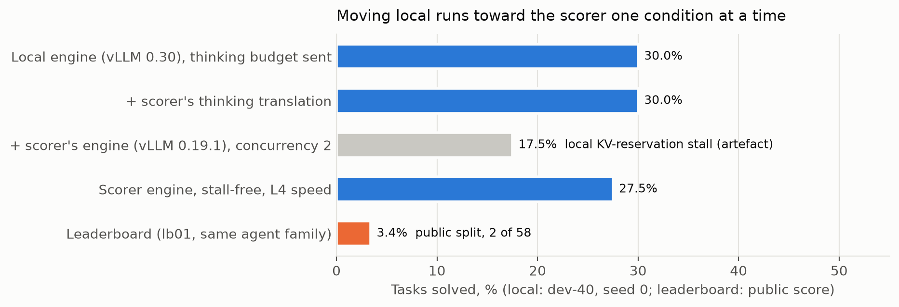
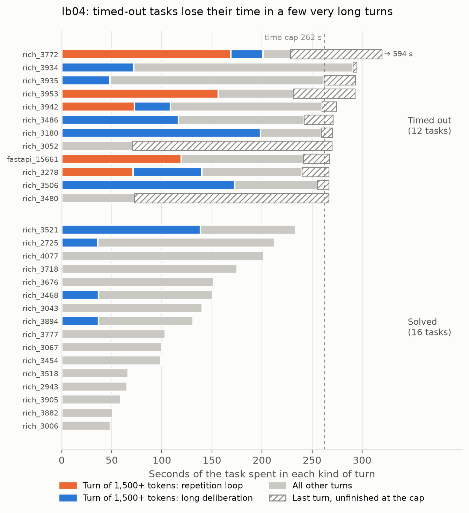
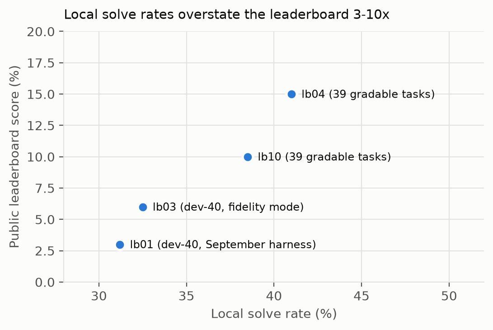

# Runtime-Bound: What Limits a Local 31B Coding Agent, and What Local Evaluation Gets Wrong
*Subtitle: on a fixed 12-hour, 32k-context scorer, the runtime decides more than the prompt, the adapter or the weights*

<!-- Kaggle Paper Track: 3,000 words max. Required: title, subtitle, abstract, introduction,
     methods and experiments, related work and citations. Judged on Novelty, Quality (generality),
     Relevance, Verifiability, Clarity. DRAFT 1 (2026-11-08). Every number is traced to a run in
     docs/design_changes.md; [TODO] marks items still to verify or add. -->

## Abstract

We spent seven weeks and one consumer GPU (RTX 5090, 32 GB) trying to improve a Gemma 4 31B
(int4) software-engineering agent for a scorer that runs about 120 hidden tasks in 12 hours on
4×L4 GPUs with a 32k context. We report what limited it. First, accounting: 90% of the starter
agent's failures were context exhaustion caused by one setting, a 16k output reserve inside a 32k
window; fixing that line raised the local solve rate from 18.8% to 31.3% (paired, p = 0.006).
Second, a fidelity ladder that moves local runs toward the scorer one condition at a time. It
found three scorer-side defects (thinking budget never sent, earlier reasoning dropped from the
prompt, LoRA weights wiped), all later confirmed or fixed by the organizers, and three local
artefacts that would have misled us. Third, an anatomy of wall-clock: timed-out tasks lose 62% of
their time in 1–3 turns that think to the 4,096-token cap, half of them repetition loops. Fourth,
ten agent-side interventions, from planning layers and sub-agents to self-generated LoRA and
activation-guided weight edits, none of which beat the tuned single agent. The common cause is the
runtime: the time cap, the context window and the way history is compacted. We release the
tooling that made these measurements reproducible.

## 1 Introduction

Small open models are now good enough to fix real GitHub issues some of the time, and the Gemma 4
Developer Agent competition asks how far a 31B model can go under a fixed budget
[@gemma4paper2026]. The natural levers are the ones the submission format exposes: the system
prompt, the agent graph, sampling, and LoRA adapters. Our thesis is that on this scorer these
levers matter less than the runtime around the model: the wall-clock cap, the 32k window, how
much of it is reserved for output, and how history is kept or compacted between turns.

We test the thesis with paired experiments on public tasks, reproduced on the scorer's own
engine and harness. Contributions:

1. **Accounting (C1).** A token and failure taxonomy of 387 starter runs. One configuration line
   explains most failures, and fixing it gives the largest gain we measured.
2. **Fidelity ladder (C2).** A cumulative local-to-scorer decomposition that separates real scorer
   effects from local artefacts, with three defects reported to and fixed by the organizers.
3. **Wall-clock anatomy (C3).** Where the time goes in tasks that run out of it, and why simple
   caps do not recover it.
4. **Negative results (C4).** Ten interventions, each tested paired against the same baseline,
   including self-bootstrapped fine-tuning on a rented H100 and activation-guided weight edits.
5. **Measurement lessons (C5).** Why a public-task screen ranked our variants differently from the
   leaderboard, and what a reliable local proxy needs.

## 2 Setting

**Scorer.** The model is `gemma-4-31b-it-qat-w4a16-ct` served by vLLM 0.19.1 [@kwon2023vllm] on
4×L4 with a 32,768-token window. Agents are declarative (YAML, prompts, sampling, tools from a
closed registry, optional adapters) and run in Google ADK; each task gets an offline Docker
sandbox, a tool-call cap, a per-task time cap, and the whole run must finish in 12 hours.
Overrunning it returns no score. Hidden tasks come from repositories that are not in the public
set [forum 742882].

**Local replica.** One RTX 5090 serves the same checkpoint with the scorer's vLLM build and
flags, installed from the organizers' wheelhouse, and the official harness (swegemma) runs the
tasks. The L4 box decodes about 1.6× slower, so we scale the per-task cap by 0.625 (7 min becomes
4.375 min) and run one task at a time, as the scorer does.

**Tasks.** 129 public tasks (fastapi 67, rich 48, requests 13, httpx 1). Only 41 can be graded
offline with the released environment (Section 4.5), so later screens use the 39 gradable,
non-pathological tasks. For training data we also ingested 142 SWE-rebench tasks from other
repositories.

**Statistics.** Every comparison is paired on the same tasks: differences with bootstrap 95%
intervals and exact McNemar tests [@agarwal2021rliable]. With 39–80 pairs, differences of ±3
tasks are within noise, and we say so where it applies.

## 3 Method: the fidelity ladder

A local score is only useful if it predicts the scorer. Our first submission solved 31% of tasks
locally and scored 0.03 on the board. Instead of changing the agent, we moved the local setup
toward the scorer one condition at a time, keeping the agent fixed and pairing each step with the
previous one:

1. **Adapters.** A canary LoRA (random `lora_B`) produced output identical to the base model on
   the scorer's original vLLM build: adapters were silently wiped. Removing the starter adapter
   locally changed nothing (30.0% vs 30.0%).
2. **Thinking translation.** The harness validated `thinking_budget` but never sent it to vLLM; on
   the scorer, thinking was bounded only by `max_output_tokens`. Locally the effect was zero.
3. **Engine.** Replaying 164 recorded requests on both engines showed that vLLM 0.19.1 dropped the
   assistant's earlier `reasoning_content` from the prompt (median 418 tokens shorter at turns
   2–4, 2,583 from turn 5), so the model re-derived its plan every turn. The newer engine kept it
   and instead ran out of context. Stall-free, the two engines solved 27.5% and 25.0% (paired
   −2.5 [−15, +10]) and failed in opposite ways: 22 timeouts versus 35% context deaths.

*Figure 1. The fidelity ladder. Each bar adds one scorer condition to the previous one (same
agent, dev-40, seed 0). The grey bar is a local artefact, not a scorer effect (see below).
Even the stall-free scorer replica solves 8× more than the board.*

All three defects were reported on the competition forum and later confirmed or fixed (adapters
load and thoughts are kept in the current wheelhouse). Three local artefacts nearly misled us and
are worth naming because they are easy to repeat:

- **KV reservation.** vLLM's YAML config loader silently drops boolean `false`, so
  `scheduler-reserve-full-isl: false` was never applied. At concurrency 2 this produced request
  stalls that we first mistook for a 12.5-point engine effect.
- **Wheel cache.** The harness caches unpacked dependency wheels under a fixed name that ignores
  which wheel set built it. It poisoned our first gradability sweep, and two months later a cache
  built from 1,450 SWE-rebench wheels broke pytest on every public task of an adapter screen
  (0/19 solved; the rerun with an isolated cache solved 9/32).
- **Telemetry.** We log every run with a manifest and 1 Hz GPU telemetry, so these artefacts were
  found by inspecting traces rather than by a lucky reading of a score.

## 4 Results

### 4.1 Accounting: one line explained most failures (C1)

Across 387 starter runs (129 tasks × 3 seeds, 6-minute cap) the agent solved 24.3% [20.3, 28.8].
Of 250 failures, 90.4% were context exhaustion; wrong edits were 6% and mislocalization under 2%.
Token accounting located the cause: the starter sets `max_output_tokens: 16384`, which vLLM
reserves out of the 32k window, leaving a 16k prompt that a few file reads fill. Truncated tool
output was 21% of prompt tokens and re-prefill after resets 13%; re-reading files was only 2%.

| Arm (dev-40, 2 seeds) | Solved | Context deaths | Paired vs A |
|---|---|---|---|
| A starter | 18.8% | 73.8% | — |
| B output reserve = thinking + 4,096 | **31.3%** | 23.8% | **+12.5 [+5.0, +21.3], p = 0.006** |
| C = B + prompt guidance | 31.3% | 25.0% | +12.5, p = 0.02 (C − B = 0) |
| D = B + fresh-context retry | 32.5% | 10.0% | D − B +1.3, n.s. |

One configuration line was worth more than any prompt or architecture change we tried later.

### 4.2 Context architecture: a phase agent does not help under the real budget (C4)

Our pre-registered headline was a phase-decomposed agent (localize, reproduce, edit, verify) with
fresh contexts per phase, designed so the window behaves like a prefix-closed cache
[@belady1966]. Under generous local budgets it tied the fixed single agent (+2.5 [−3.8, +10.0],
80 pairs; pre-registered bar +5). Its read-only localizer looped on identical tool calls in 28/79
runs (one grep 335 times) against 1/80 for the single agent, a near-greedy sampling effect
(temperature 0.2) that Gemma's recommended sampling removed. Under scorer conditions the phase
agent lost: 25.0% and 17.5% for two variants against 32.5% for the single agent with thinking off
(−15 [−27.5, −2.5] for the second). Splitting an already short budget across phases leaves each
phase too little.

### 4.3 Where the wall-clock goes (C3)

On the fixed scorer engine our best configuration, lb04 (public recipe: thinking budget 4,096,
temperature 0.2, 28 calls, 7 min), solved 16/39 locally. Its 12 timed-out tasks look different from
its solved ones:

| lb04, 39 tasks | Longest turn (median, tokens) | Turns > 1,500 tokens | Time in the 3 slowest turns | First edit (median) |
|---|---|---|---|---|
| Solved (16) | 968 | 0.3 | 42% | 44 s |
| Timed out (12) | 4,130 (at the cap) | 1.8 | 62% | 195 s; 5 never edit |

*Figure 2. Where each task's time goes (lb04, the 12 timed-out and 16 solved tasks). Turns of
1,500+ output tokens are split into repetition loops (more than 25% duplicated sentences) and
long deliberation; the hatched segment is the final model call, still generating when the cap
hit and therefore absent from the trace.*

Of the 18 turns that reached 3,000 tokens, 8 were repetition loops (more than 25% duplicated
sentences; one repeated the same two sentences for 4,100 tokens), the rest long genuine
deliberation. Two cheap fixes each address half the problem and lose elsewhere. Capping thinking
at 2,048 removed the long turns but solved 12/39, since deliberation is sometimes what solves the
task. Raising the temperature to 1.0 on the same 12 tasks cut loops from 7 to 1 and timeouts from 12
to 5, but most tasks then hit the call cap with wrong patches: 2 of the 12 were solved, against 0.
We ran this arm only on the timed-out tasks, so what it costs on the tasks lb04 solves is
unmeasured (Section 6). On hard tasks the loop is a symptom of not knowing the fix, not the
reason the fix is missing.

### 4.4 Ten interventions that did not beat the tuned single agent (C4)

All rows are paired against lb04 on the same 39 tasks at scorer fidelity unless noted.

| Intervention | Solved | Note |
|---|---|---|
| lb04 baseline | 16/39 | board 0.15 |
| Thinking budget 2,048 | 12/39 | long turns gone, solves lost |
| Audit rules in the prompt | 14/39 | — |
| Graph tools removed, 36 calls / 6 min, T = 1.0 | 14/39 | time-capped 15 → 23 |
| Notes file in /tmp | 14/39 | slower (5.9 vs 5.5 scorer-min/task) |
| Skill helper scripts | 13/39 | empty patches 11 → 17 |
| Zero-call plan + status line | 15/39 | empty patches 11 → 9; **board 0.10** |
| Plan + forced edit by call 10 | 13/39 | empty patches 16 |
| Locator sub-agent | 12/39 | sub-agent used 13.9 calls of the shared 28 |
| Self-generated LoRA (r16, all linear) | 9/32 vs 12/32 | screen stopped at 32 tasks |
| Activation-guided weight edit (12B) | null | no edit cleared the bar without damage |
| 12B with the same agent | 7/39 | — |

**Self-generated fine-tuning.** We rejection-sampled 113 solved runs (118 tasks, 5.3M tokens, 39
public tasks held out) from plain and hinted runs on public and SWE-rebench tasks, masked failed
tool calls from the loss, and trained a rank-16 LoRA on all linear layers of the int4 model (122M
parameters; 2 epochs on a rented H100, $26.58). Held-out validation loss fell from 0.383 to 0.277
and 0.273, but the adapter solved 9 of 32 against 12 of 32: it gained no task, behaved almost
identically (20.3 vs 21.6 calls per task) and decoded 14% slower. Lower loss on the model's own
successful runs taught it to reproduce them, not to solve new tasks [cf. @pan2025swegym].

**Weight edits.** On the 12B model, the most failure-linked behaviour was re-fetching content the
agent had already seen. Activation analysis showed why an edit cannot remove it: in 32 of 60 cases
the content had been removed from the prompt by ADK's compaction, whose summarizer reads only text
parts and ignores tool calls and results [forum 754783]. The re-read is rational; the defect is in
the runtime, not the weights.

### 4.5 Measurement: why the local screen misranked variants (C5)

Three facts limit any local proxy for this board:

- **Public tasks are mostly ungradable offline.** With the released environment only 41 of 129
  gold patches pass (rich 39/48, httpx 1/1, fastapi 1/67, requests 0/13): missing test packages,
  SSL failures on Python 3.13, installed packages shadowing the workspace. The organizers confirm
  hidden tasks validate at 100%, so the screen is biased toward one repository (36 of our 39 tasks
  are `rich`).
- **The board is coarse.** About 60 tasks make the public split, so one task is 0.017. Public runs
  of identical files scored 0.17 to 0.24, and eleven teams sit at exactly 0.24, the score of a
  public notebook that differs from our lb04 only in its time cap (8 vs 7 minutes).
- **Process gains did not transfer.** The planning variant improved every process metric locally
  (fewer empty patches, fewer call-capped tasks, 15/39 vs 16/39) and scored 0.10 against lb04's
  0.15.

*Figure 3. Local solve rate against public leaderboard score for our four scored submissions.
The local rate is 3–10× the board; lb10 and lb04 were within noise locally (15/39 vs 16/39)
and 0.05 apart on the board.*

A screen built from many repositories (we have 142 ingested SWE-rebench tasks) is the obvious
next proxy; we did not have time to validate it against the board.

## 5 Related work

SWE-bench [@jimenez2024swebench] defines the task format; agent scaffolds such as SWE-agent
[@yang2024sweagent] and the procedural Agentless pipeline [@xia2024agentless] show how much the
interface and workflow matter for a fixed model, which our accounting result confirms at the level
of a single configuration value. SWE-Gym [@pan2025swegym] trains open models on agent
trajectories and reports that self-improvement without a stronger teacher is limited; our LoRA
result is a budget-constrained instance. Rejection-sampling fine-tuning follows STaR
[@zelikman2022star]; low-rank adaptation of quantized models follows LoRA and QLoRA
[@hu2022lora; @dettmers2023qlora]. Repetition loops at low temperature are the degeneration
described by Holtzman et al. [@holtzman2020degeneration]. Our context-as-cache framing borrows
from replacement policies [@belady1966]; serving behaviour depends on vLLM's scheduler and KV
management [@kwon2023vllm]. Statistical practice follows [@agarwal2021rliable].

## 6 Limitations and reproducibility

The hidden tasks are private, so every local number is a proxy, and our screen over-represents one
repository. Most comparisons use one seed on 39–80 tasks; we report intervals and treat ±3 tasks
as noise. The L4 time scaling models decode speed only. Board scores are single noisy draws.
The temperature-1.0 arm was run only on the 12 tasks lb04 timed out on, and the self-generated
LoRA screen was stopped at 32 of 39 tasks; neither has a full paired run. The weight-edit study
used the 12B model, not the 31B one.

Everything is reproducible from the repository [TODO: public link]: run manifests and telemetry for
every run, the fidelity tooling (scorer-engine environment pinned from the wheelhouse, official
harness runner with per-pool wheel caches, compile checker), the gradability sweep, the
replay proxy, the timeout and loop analysis scripts, and `docs/design_changes.md`, which records
every deviation from the pre-registered plan with the evidence available at the time. No
competition data is redistributed.

## References

See `refs.bib`.
